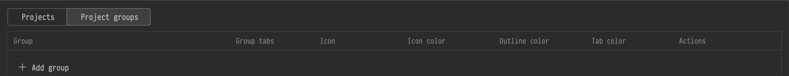

# Project Tab Icons

## Local by design

> No accounts, telemetry or plugin network requests. [Privacy](PRIVACY.md).

---

## Install in a minute

### [↓ Download ZIP](https://github.com/vlaslaptev/project-tab-icons/releases/download/v0.3.62/project-tab-icons-0.3.62.zip)

1. Open **Settings → Plugins → ⚙ → Install Plugin from Disk…** and select the ZIP.
2. Open several projects in separate windows, then use **Window → Merge All Project Windows**.
3. Open **Settings → Appearance & Behavior → Project Tab Icons**.

**Choose a preset, assign your project icons, and click Apply.**

The [installation guide](docs/INSTALLATION.md) covers missing tabs, updates and removal.

## Main features

### You can change tab height, text size and the close button’s position
### You can give each project its own outline and translucent fill colors
### You can adjust fill intensity and return to your last Custom appearance
### You can start with a preset, adjust it and see the result before Apply
### You can save up to 10 named presets for your own tab styles
### You can preview your tabs in different IDE themes

---

### You can assign an icon to each project tab and place it on the left or right
### You can pick from 100+ icons, import your own SVG or use your project’s initials
### You can import SVG folders as categories and create text icons such as DB, QA or API
### You can adjust the icon’s color and size to make each project easy to recognize

## One group. One shared style.

Create and edit groups directly in the table. Give a group its own **icon**, **icon
color**, **outline color** and **tab color**; every member inherits them, including
projects assigned later. **Ungroup** restores each project's individual style.
The Projects tab keeps paths below project names and shows membership in a separate
**Group** column, with **—** for ungrouped projects.

Enable **Group tabs**, use **↑ / ↓** to arrange groups, and give members optional
fixed positions. For example:

| Member | Position on merge |
| --- | --- |
| Tools | 1 |
| Backend | Auto |
| Frontend | Auto |

Tools comes first; Auto members retain their relative order. Group order follows
the group table. Ordering runs when windows are merged, and you can move tabs
freely afterwards. **Restore Group Tab Order** in the tab context menu reapplies
the saved arrangement. Existing groups keep grouping off until enabled.

## Quick actions and portable styles

Use **Tools → Project Tab Icons** or **Find Action** to change the current project's
icon and colors, choose a preset or open Settings. Shortcuts are configurable.
**Manage…** updates, duplicates and reorders saved presets. **Import styles…** and
**Export styles…** share selected appearance presets, SVG categories and text icons
as JSON, with choices for name conflicts. Project paths and group memberships stay local.

## About the plugin

### Find the right project before you read its name.

**Project icons**, **colored outlines**, **translucent fills** and **Git context**
for IntelliJ IDEA's **macOS window tabs**.

Give each project a visual identity and keep the information you need beside its name.

- **Platform:** macOS
- **IDE:** IntelliJ IDEA **2026.2.3** / build **262**
- **Version:** **0.3.62**
- **License:** MIT

> **Updates & future IDE support**
>
> Updates and support for newer IntelliJ IDEA versions are planned.

**Independent · Experimental · Distributed through GitHub**

## 100+ shapes. Your colors.

Search by name or keyword, filter by category, and choose a color with the native
IDE picker, a HEX value, or one of 14 swatches. Icon sizes are **20, 24 and 28 px**.
Your existing SVG/PNG artwork keeps its own colors.

Import a folder and its SVG subfolders as a shared category, with search and original
colors. Copies remain available after moving the source folder. Or open **Text icon**
to create a 1–6-character label with four styles, three font families and a custom color.
Text icons save as transparent SVG paths and can be edited later. Apply saves library
imports and project assignments; Cancel discards the draft.

Selected SVG icons are saved in the IDE's native project icon storage. They remain
project icons after the plugin is removed. Replacing an icon updates that project's
light and dark variants; keep a copy if you want to restore custom artwork later.

## Project notes

- [Compatibility and internal APIs](docs/COMPATIBILITY.md)
- [Feature guide](docs/FEATURES.md)
- [Architecture](docs/ARCHITECTURE.md)
- [Contributing](CONTRIBUTING.md)
- [Third-party artwork and licenses](THIRD_PARTY_NOTICES.md)

The appearance and Git slides use two crops from **the installed 0.3.62 Settings
page**, captured on **20 October 2026**. They show Custom appearance and the plugin's
built-in Frontend, Backend and Tools fixtures. The group image includes only the
switcher, column header and Add group row; saved groups and real project paths are
excluded. The icon-library slide is an illustration made from the plugin's SVGs.
[Media sources and capture provenance](docs/media/README.md) describe each crop.

This project is independent of JetBrains and is not an official JetBrains product.
