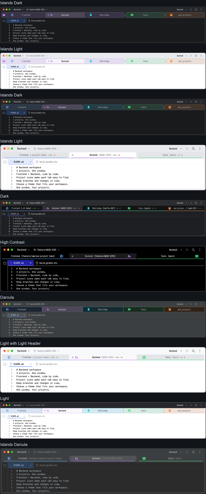
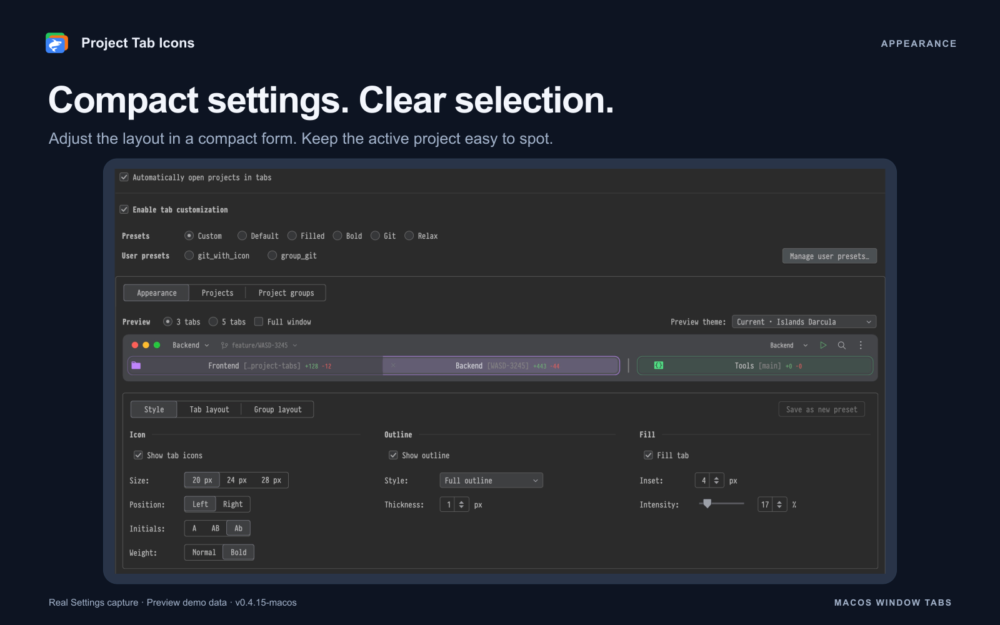
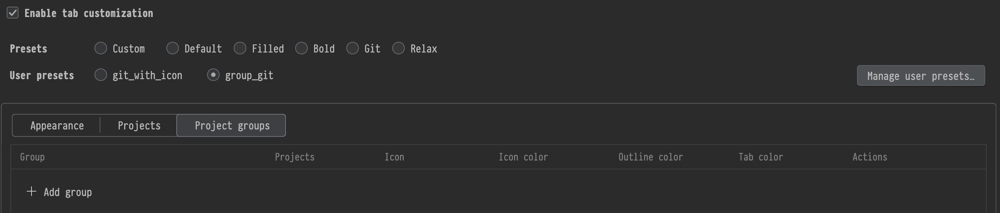
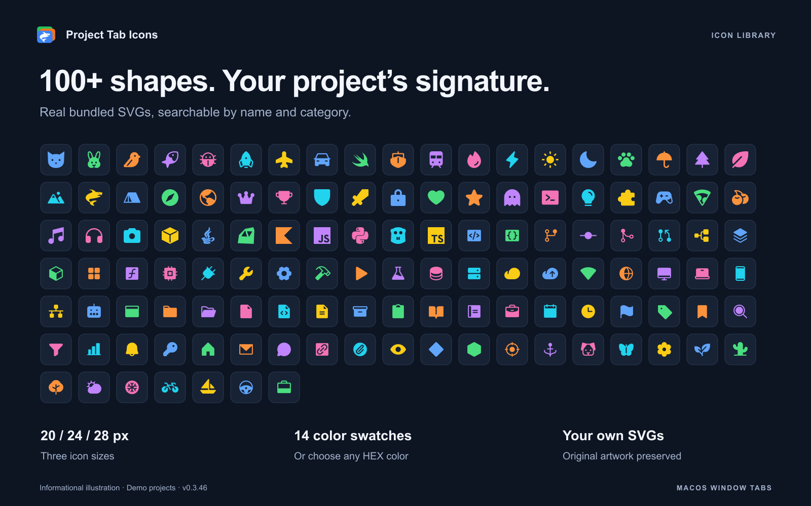
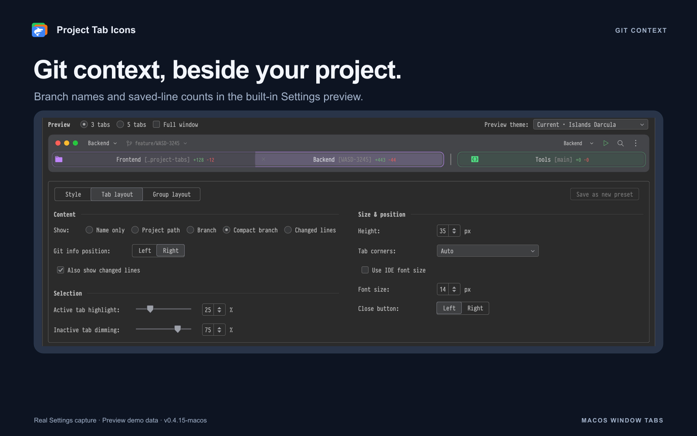
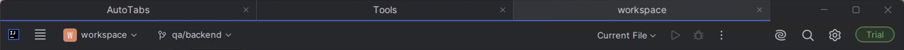
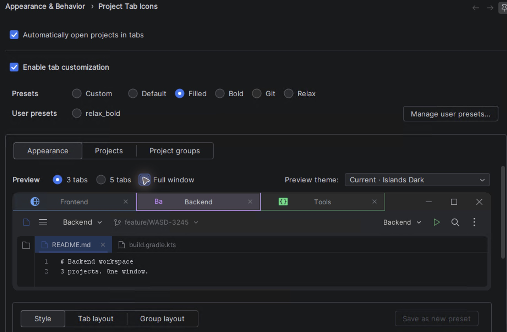

# Project Tab Icons

Project icons, colored outlines, adjustable fills, groups and Git context for
**IntelliJ IDEA project window tabs on macOS** and merged project windows on Windows.
Editor file tabs keep their usual appearance.

## Installation

- [macOS ZIP](https://github.com/vlaslaptev/project-tab-icons/releases/download/v0.4.16/project-tab-icons-0.4.16-macos.zip)
- [Windows ZIP](https://github.com/vlaslaptev/project-tab-icons/releases/download/v0.4.16/project-tab-icons-0.4.16-windows.zip) 

1. Open **Settings → Plugins → ⚙ → Install Plugin from Disk…** and select the downloaded ZIP.
2. Open several projects in separate windows, then use **Window → Merge All Project Windows**.
3. Open **Settings → Appearance & Behavior → Project Tab Icons**, choose a preset, adjust it and click **Apply**.

## Automatic project tabs on macOS

Enable **Tools → Project Tab Icons → Automatically open projects in tabs**, or use
the same option in the plugin settings and click **Apply**.

When macOS prefers tabs **Always**, the option is already selected and disabled.
With **Manually** or **In Full Screen**, you can enable automatic tabs just for IDEA.
The plugin leaves macOS preferences unchanged and stores this choice separately
from its Windows preference and appearance presets.

A new project joins the most recently active tab group. If there is no group,
it joins the previously active project. Enabling the option does not merge
existing windows, and disabling it does not separate their tabs.
Choose **New Window** if IDEA asks where to open a project.

## Style tabs and groups. Hundreds of combinations. Every IDE theme.

Choose tab height, text size, icon position, outline, fill and group styling independently.
The gallery shows ten examples from the plugin's real Preview renderer, with everyday
tab sizes and readable colors. They are a small selection of the available combinations.

## Make each project easy to recognize

- Set tab height, text size and close-button position.
- Choose Auto, Square or IDEA theme corners. Auto follows the theme on macOS and uses square corners on Windows.
- Choose a bottom line, rounded lower outline or full frame, with independent outline and fill colors.
- Adjust fill intensity and inset, and place project icons on either side of the title.
- Start with a built-in preset or save up to 10 named presets. Custom remembers your last manual appearance.
- Preview **three or five tabs** in any of the **eight IDE themes** before applying changes.
- Adjust **Active tab highlight** and **Inactive tab dimming** independently, including inside groups.
- Tab surfaces stay opaque above the IDE project gradient; the gradient remains visible around their contours.
- Click a sample tab to compare active and inactive states. Preview theme and sample count stay local to the example window.

The **Light** preview uses light tab surfaces and readable text while keeping its dark toolbar.
**Full window** adds file tabs and an editor fragment; Preview starts compact.
The Appearance and Git screenshots below show installed 0.4.15-macos, captured on
29 October 2026. The examples gallery is from 0.3.97; the Project groups capture is from 0.3.120.

## Compact controls, a live preview

Project Tab Icons is an **IDE-wide** settings page under **Appearance & Behavior**.
The enable switch, **Presets** and **User presets** stay above all three sections
and remain visible while their contents scroll.

| Section | Use it for |
| --- | --- |
| **Appearance** | Style, Tab layout, Group layout, Preview and saving presets |
| **Projects** | Open-project icons and colors, membership and Ungroup |
| **Project groups** | Group icons and colors, members, positions and group order |

Each section keeps its own scrolling position and draft. Within Appearance,
**Style** brings **Icon**, **Outline** and **Fill** together. **Tab layout** places
**Content** and **Selection** in the left column and **Size & position** on the right.
**Use IDE font size** follows the IDE automatically; clear it for a fixed size.
Pixel dimensions use compact number fields. Percentages have a slider and a
synchronized exact input. Narrow windows stack the columns.
**Save as new preset** sits beside **Style / Tab layout / Group layout**.

## Start with a preset

| Preset | Icons | Outline | Height and extras |
| --- | --- | --- | --- |
| **Default** | 24 px | Bottom, 2 px | 33 px; IDE font; Git branch on the right; no fill |
| **Filled** | 20 px | Full, 1 px | 34 px; 12% fill with a 3 px inset; no extra info |
| **Bold** | 28 px | Full, 4 px | 38 px; 16 px text; no fill or extra info |
| **Git** | Hidden | Bottom, 2 px | 33 px; compact branch and line counts on the right |
| **Relax** | Hidden | Bottom, 1 px | 33 px; 14 px text; no fill or extra info |

Built-in presets keep your **Group layout** settings. Manual edits select **Custom**,
which remembers your last manual appearance when you try another preset.
**Apply** saves that memory for the next IDE session.

**Restore defaults** selects Default and resets Group layout too, including group
highlighting, shared icons, spacing and pipes. Group membership, individual project
icons and colors, and the global customization switch stay unchanged.
The reset remains a draft until you click Apply; Cancel discards it.

## One group. One shared style.

Create and edit groups in **Project groups**. Assign an icon, icon color, outline color
and tab color to the group; members inherit them, including projects added later.
In **Projects**, **Inherited from …** explains the source and **Edit group** opens
the matching group. Inherited values stay readable. **Ungroup** restores each
project's personal styling.

Only the header and Add group row are shown; saved working groups are outside the crop.
Use **+** in **Actions** to search for projects and add several at once. Every opening
starts with an empty selection, independent of checkboxes in Projects. The edit button
changes the name, membership and fixed positions; the trash button removes a group.
Settings **Apply** or **OK** also saves and validates an unfinished group edit.

Under **Group layout → Group highlight → Variant**, choose **Shared background** or
**Joined tabs**. Both follow regular tab dimensions, theme corners, fill settings,
active and hover colors, and **Style → Icon → Size**. Tune active-card inset or
internal dividers, and show a shared group icon with optional hidden member icons.
Add spacing and vertical pipes between groups.

While dragging inside a group, its original boundaries and separators stay fixed.
Dragging outside previews the split; moving the tab back before release restores
the grouped appearance. Transparent drag margins keep neighboring tabs readable.

Groups are placed on the left in group-table order when windows merge, followed by
ungrouped projects. Use **↑ / ↓** to reorder groups and optional fixed member positions
to put a project first within its group. Manual rearrangement remains available;
**Arrange Tabs by Group** reapplies the saved order.
**Open All Grouped Projects** opens missing group members, merges their windows
and arranges the tabs; it is also available in **Tools → Project Tab Icons**. A manually split group's shared
decoration stays hidden until **Arrange Tabs by Group** succeeds. Moving the tabs
back manually, applying settings, merging windows again or restarting the IDE does
not restore that decoration. Members keep their inherited project styling.

## 100+ shapes. Your colors.

Search icons by name or category, choose a color with the native IDE picker, a HEX
value or one of 14 swatches, and select **20, 24 or 28 px** icon sizes.

Import an SVG or add a folder of SVGs, including subfolders, as a library category.
Existing custom artwork keeps its colors. **Text icon** creates editable 1–6-character
labels such as DB, QA or API, with four styles, three font families and a custom color.
Individual project artwork is saved in IDEA's native project icon storage and remains
a project icon after removing the plugin.

Each imported icon can be up to **2 MiB**. A folder import or category can contain
up to **500 SVGs**; the imported library holds up to **50 categories** and **16 MiB**.
The plugin stores copies, so moving the source folder keeps the icons available.
Invalid SVGs are skipped with a report, and duplicates within a folder are combined.
Use self-contained, static SVGs without scripts, foreignObject, DOCTYPE or external resources.

## Git context beside the project name

Show full or compact Git branches, tracked added/removed-line counts, or both.
Choose whether extra information appears before or after the project name.
Counts cover saved tracked changes against HEAD, including staged and unstaged
changes. Git4Idea supplies branches; local background diffs supply counts without
fetching from remotes.

In **Tab layout → Content → Show**, choose **Name only**, **Project path**, **Branch**,
**Compact branch** or **Changed lines**. **Also show changed lines** adds line counts
to either branch format; **Git info position** selects the side of the project name.
Background diffs run only while counts are requested. Outside a Git repository,
the tab shows **[No repo!]** without counters; clean repositories show **+0 -0**.
Untracked files, binary files and unsaved editor text are excluded. Compact branches
use the part after the final `/`, keeping at most **13 Unicode characters**, including
a leading ellipsis. The full branch remains available in the tooltip.

## Quick actions and portable styles

Use **Tools → Project Tab Icons** or **Find Action** for current-project styling,
preset switching and Settings. View or change shortcuts in **Settings → Keymap**.
For a grouped project, edit its inherited icon and colors in **Project groups**.

**Save as new preset** creates a new named style on Windows and macOS.
Editing a saved preset leaves the original intact. **Manage user presets…** in the
shared header renames, duplicates, deletes and reorders
saved presets. Use unique names of up to **32 characters**. Preset changes are saved
with Apply; Cancel discards the draft.

**Import styles… / Export styles…** shares selected presets, SVG categories and
editable text icons as JSON, up to **24 MiB**, with **Keep both / Replace matching
names / Skip matching names** choices. Names are trimmed before conflicts are
resolved. An invalid import leaves the draft unchanged. Project paths and group
memberships stay local.

## Save changes and handle conflicts

Unsaved settings, icons and colors are marked with a dot. **Apply** saves them;
**Cancel** discards pending changes. **Revert** on a project row discards that row's
edits; **Reload** loads an icon changed outside the page.

Apply saves only the shared settings sections you edited. If another window changed
the same section, it reports a conflict and keeps your draft. Use the settings page's
**Revert changes** action to load the latest values, then repeat your edits.

## Windows support — Beta

The Windows package is in **beta** and targets IntelliJ IDEA **2026.2.3–2026.2.x**.
Install the [Windows ZIP](https://github.com/vlaslaptev/project-tab-icons/releases/download/v0.4.16/project-tab-icons-0.4.16-windows.zip)
from disk, then use **Window → Merge All Project Windows** to place projects in
one window. You can also enable **Automatically open projects in tabs** in the
plugin settings. The macOS package remains separate.

Project tabs share the top row with the native window controls, with close buttons
on the right of every tab. Changing **Show Project Gradient** preserves tab styling.

Preview uses the same row order and caption space as the merged Windows window.
In Islands Dark, the real tabs use the same gray window background as Preview.
With customization off, tabs have 1 px gray separators, a shared blue 2 px bottom
line, project names without paths and close buttons on the right.
Switch between three and five sample tabs, or enable **Full window** to include
file tabs and an editor fragment. The screenshots above were captured from the
running Windows plugin. Windows support remains beta.

## Compatibility

Use the ZIP for your operating system. Requires **IntelliJ IDEA 2026.2.3–2026.2.x**,
builds `262.10968.63` through `262.*`. The packages are unsigned and installed from disk.
Windows support is beta. Linux and the 2026.3 platform branch are not supported.

## Privacy and licenses

Project Tab Icons works locally. It has no accounts, telemetry, advertising or
independent network requests. Project paths and branch names stay on your machine.
Git captions use the IDE's repository model and a local background diff, with no fetch.

Applying a project icon replaces its native IDEA light/dark icon variants. The
imported source file is unchanged. Applying appearance settings alone does not rewrite
project icons. Saved native icons remain available after removing the plugin.

The project uses the [MIT license](LICENSE). Bundled artwork and the Gradle Wrapper
retain their [third-party notices](licenses/THIRD_PARTY_NOTICES.txt) and [licenses](licenses).
Independent of JetBrains; not an official JetBrains product.
