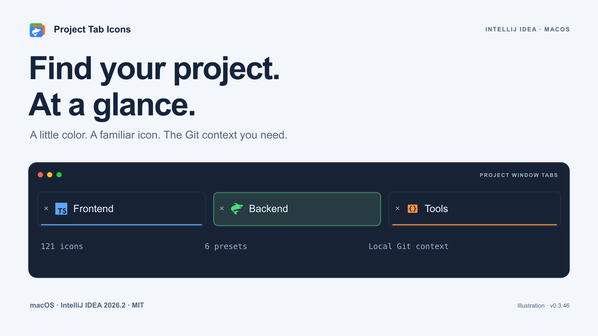
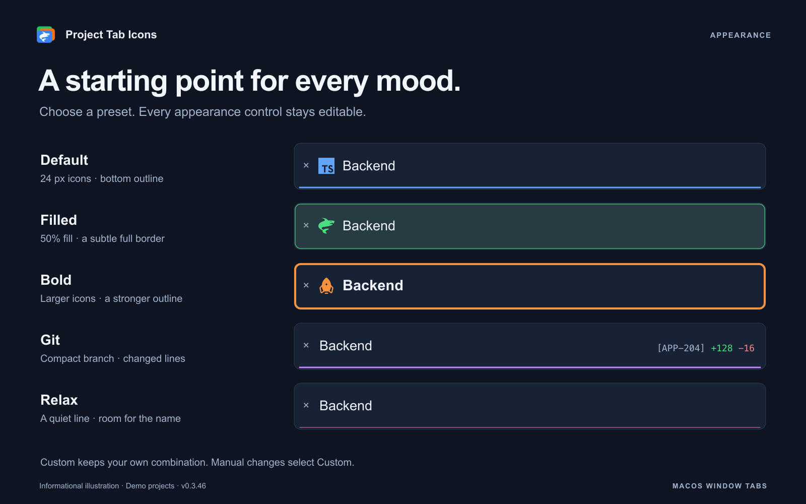
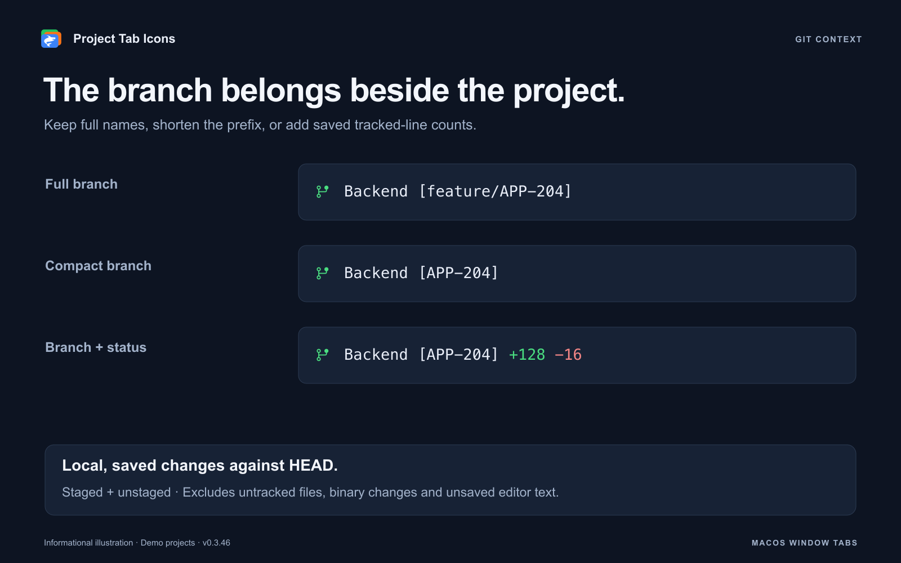

<picture>
  <source media="(prefers-color-scheme: dark)" srcset="docs/media/hero-dark.png">
  
</picture>

# Project Tab Icons

**Find the right project before you read its name.**

Project icons, colored outlines, translucent fills and Git context for IntelliJ
IDEA's **macOS window tabs**. Give each project a visual identity and keep the
information you need beside its name.

[Русский](README.ru.md) · [Install](docs/INSTALLATION.md) ·
[Features](docs/FEATURES.md) · [Compatibility](docs/COMPATIBILITY.md) ·
[Changes](CHANGELOG.md)

| Platform | IDE | Version | License |
| --- | --- | --- | --- |
| macOS | IntelliJ IDEA 2026.2.3 / build 262 | 0.3.46 | [MIT](LICENSE) |

This is an independent, experimental plugin distributed through GitHub.
It uses internal IntelliJ APIs and supports the **2026.2 branch only**.
It customizes project **window tabs**, the row you get after merging project
windows, rather than editor file tabs. See [compatibility](docs/COMPATIBILITY.md)
before installing.

## Make your projects easy to recognize

- **An icon for every project.** Browse 121 bundled shapes, import a standalone SVG,
  reuse an open project's SVG, or style generated initials.
- **Color with a purpose.** Choose independent icon, outline and tab colors.
  Keep a thin line, use a full border, or add a translucent fill.
- **Your layout.** Set icon size, icon and close-button positions, tab height,
  outline thickness and font size.
- **Git at a glance.** Show the branch, a compact branch name, changed-line counts,
  or a combination. Optional Git4Idea integration supplies the Git context.
- **Preview before Apply.** Try appearance presets and preview themes, then save
  the changes you want. Disable customization to restore the IDE's normal tab layout.

## Install in a minute

1. Download `project-tab-icons-0.3.46.zip` from this repository's **Releases**.
   The release ZIP is an unsigned, manually installed plugin.
2. Open **Settings → Plugins → ⚙ → Install Plugin from Disk…** and select the ZIP.
3. Restart the IDE if prompted.
4. Open several projects in separate windows, then use **Window → Merge All Project Windows**.
5. Open **Settings → Appearance & Behavior → Project Tab Icons**.

Choose a preset, assign your project icons, and click **Apply**.
The [installation guide](docs/INSTALLATION.md) covers missing tabs, updates and removal.

The public repository and Releases are being prepared. A download is available
only after the owner publishes the first GitHub release.

## Start with a preset. Make it yours.

| Preset | Starting point |
| --- | --- |
| Default | 24 px icons, 2 px bottom outlines, 33 px tabs and a Git branch on the right |
| Filled | 50% fill, a 5 px fill inset, 1 px full outlines and 34 px tabs |
| Bold | 28 px icons, 4 px full outlines, 16 px type and 38 px tabs |
| Git | No icons; compact branch names and added/removed-line counts |
| Relax | No icons or fill; a 1 px bottom outline, 14 px type and 33 px tabs |
| Custom | Keep your own combination of controls |

Manual appearance changes select **Custom**. Project icon assignments and the
preview theme are separate from the appearance preset.

## 121 shapes. Your colors.

Search by name or keyword, filter by category, and choose a color with the native
IDE picker, a HEX value, or one of 14 swatches. Icon sizes are **20, 24 and 28 px**.
Your existing SVG/PNG artwork keeps its own colors.

Selected SVG icons are saved in the IDE's native project icon storage. They remain
project icons after the plugin is removed. Replacing an icon updates that project's
light and dark variants; keep a copy if you want to restore custom artwork later.

## Useful Git context, quietly

Compact mode keeps the part after the final `/`, up to 13 Unicode characters,
including a leading ellipsis when needed. The full branch remains in the tooltip.
Place Git information before or after the project name.

Changed-line counts include saved **tracked** changes against `HEAD`, including
staged and unstaged changes. They exclude untracked files, binary changes and
unsaved editor text. They are line counts, not a count of changed files.

Branch information comes from the IDE's Git model. Line counts are calculated
locally in the background; the plugin does not fetch from remotes.

## Local by design

No plugin account, telemetry, advertising or independent network requests.
Appearance settings stay in the IDE, icons stay with the project, and Git context
comes from local repositories. See [privacy](PRIVACY.md).

## Project notes

- [Compatibility and internal APIs](docs/COMPATIBILITY.md)
- [Feature guide](docs/FEATURES.md)
- [Architecture](docs/ARCHITECTURE.md)
- [Contributing](CONTRIBUTING.md)
- [Third-party artwork and licenses](THIRD_PARTY_NOTICES.md)

The gallery contains **informational illustrations**, not screenshots of plugin
execution. Demo names and Git values are fictional. The icon library uses the
plugin's actual SVG resources. Media sources and provenance are in
[docs/media](docs/media/README.md).

This project is independent of JetBrains and is not an official JetBrains product.
