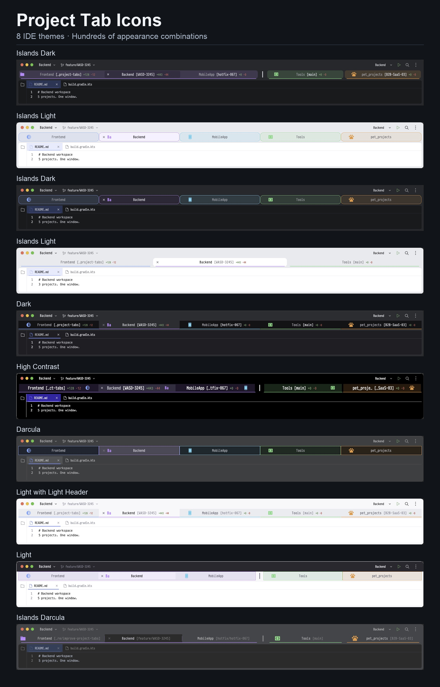

# Project Tab Icons

Project icons, colored outlines, translucent fills and Git context for IntelliJ IDEA's **macOS project window tabs**.

### [↓ Download ZIP 0.3.85](https://github.com/vlaslaptev/project-tab-icons/releases/download/v0.3.85/project-tab-icons-0.3.85.zip)

## 8 IDE themes. Hundreds of appearance combinations.

Choose tab height, text size, icon position, outline, fill and group styling independently.
The gallery shows ten examples from the installed plugin; they are a small selection of the available combinations.

## Install in a minute

1. Open **Settings → Plugins → ⚙ → Install Plugin from Disk…** and select the downloaded ZIP.
2. Open several projects in separate windows, then use **Window → Merge All Project Windows**.
3. Open **Settings → Appearance & Behavior → Project Tab Icons**, choose a preset, adjust it and click **Apply**.

Requires **macOS** and **IntelliJ IDEA 2026.2.3**, builds `262.10968.63` through `262.*`.
The plugin customizes project window tabs; editor file tabs use the IDE's normal appearance.
See the [installation guide](docs/INSTALLATION.md) for updates, missing tabs and removal.

## Make each project easy to recognize

- Set tab height, text size and close-button position.
- Choose a bottom line, rounded lower outline or full frame, with independent outline and fill colors.
- Adjust fill intensity and inset, and place project icons on either side of the title.
- Start with a built-in preset or save up to 10 named presets. Custom remembers your last manual appearance.
- Preview **three or five tabs** in any of the **eight IDE themes** before applying changes.
- Click a sample tab to compare active and inactive states. Preview theme and sample count stay local to the example window.

The **Light** preview uses light tab surfaces and readable text while keeping its dark toolbar and light editor.

## One group. One shared style.

Create and edit groups in **Project groups**. Assign an icon, icon color, outline color
and tab color to the group; members inherit them, including projects added later.
**Ungroup** restores each project's personal styling.

Under **Group layout → Group highlight → Variant**, choose **Shared background** or
**Joined tabs**. Both follow regular tab dimensions, theme corners, fill settings,
active and hover colors, and **Icon → Size**. Tune inactive-group dimming, active-card
inset or internal dividers, and show a shared group icon with optional hidden member icons.
Add spacing and vertical pipes between groups.

Groups are placed on the left in group-table order when windows merge, followed by
ungrouped projects. Use **↑ / ↓** to reorder groups and optional fixed member positions
to put a project first within its group. Manual rearrangement remains available;
**Arrange Tabs by Group** reapplies the saved order. A manually split group's shared
decoration stays hidden until that action restores its contiguous arrangement.

## 100+ shapes. Your colors.

Search icons by name or category, choose a color with the native IDE picker, a HEX
value or one of 14 swatches, and select **20, 24 or 28 px** icon sizes.

Import your own SVG or a folder of SVG categories. Existing custom artwork keeps its
colors. **Text icon** creates editable 1–6-character labels such as DB, QA or API,
with four styles, three font families and a custom color. Selected artwork is saved
in IDEA's native project icon storage and remains a project icon after removing the plugin.

## Git context beside the project name

Show full or compact Git branches, tracked added/removed-line counts, or both.
Choose whether extra information appears before or after the project name.
Counts cover saved tracked changes against HEAD, including staged and unstaged
changes. Git4Idea supplies branches; local background diffs supply counts without
fetching from remotes.

## Quick actions and portable styles

Use **Tools → Project Tab Icons** or **Find Action** for current-project styling,
preset switching and Settings. Shortcuts are configurable. **Manage…** updates,
duplicates and reorders saved presets. **Import styles… / Export styles…** shares
selected presets, SVG categories and editable text icons as JSON, with name-conflict
choices. Project paths and group memberships stay local.

## Local by design

No accounts, telemetry or plugin network requests. [Privacy](PRIVACY.md).
The unsigned ZIP is distributed through GitHub. This experimental plugin uses
internal IntelliJ and AppKit APIs; [compatibility notes](docs/COMPATIBILITY.md)
describe the supported environment and recorded validation limits.

- [Feature guide](docs/FEATURES.md)
- [Changelog](CHANGELOG.md)
- [Architecture](docs/ARCHITECTURE.md)
- [Contributing](CONTRIBUTING.md)
- [Third-party artwork and licenses](THIRD_PARTY_NOTICES.md)
- [Media sources](docs/media/README.md)

MIT licensed. Independent of JetBrains; not an official JetBrains product.
